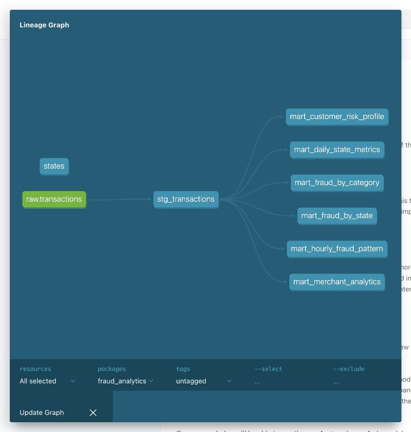

# Домашнее задание 4

## Что сделано в работе

1) В `dbt/models/sources/sources.yml` описана исходная таблица `transactions_db.transactions`. `scripts/load_data.py` загружает в неё данные из `train.csv`.

2) `dbt/models/staging/stg_transactions.sql` приводит типы и названия полей, убирает крайние пробелы, добавляет дату, час, день недели, ключ клиента и сегмент суммы.

3) В `dbt/models/marts/` находятся шесть витрин: дневные метрики по штатам, фрод по категориям и штатам, профиль риска клиентов, временные паттерны фрода и аналитика продавцов.

4) В `dbt/macros/` находятся макросы для сегментации суммы, а также уровня риска. Используются пакеты `dbt_utils`, `dbt_date` и `dbt_expectations`. Модели, поля и базовые тесты описаны в yaml-файлах. Отдельно добавлены SQL- и unit-тесты.

5) dbt строит документацию с описаниями моделей и графом зависимостей.

Версии: `dbt-core==1.9.8`, `dbt-clickhouse==1.9.5`.

## Запуск

Клоннируем репу и заходим в нее.

```bash
git clone https://github.com/iivancataew2017-lgtm/mlops-hw-4.git
cd mlops-hw-4
```

Скачиваем [датасет](https://www.kaggle.com/competitions/teta-ml-1-2025/data) из предыдущих домашних заданий. Нужен файл `train.csv` с исходными колонками. Положите его в папку `data/` внутри проекта.

Установка зависимостей:

```bash
make install
```

Поднимаем ClickHouse и устанавливаем пакеты dbt:

```bash
make up
make deps
```

Нужно заменить путь к CSV на свой и загрузить данные:

```bash
make load CSV="data/train.csv"
```

Загрузку выполняем один раз в пустую таблицу. При повторном запуске `make load` строки добавятся повторно.

Собираем проект и документацию:

```bash
make build
make test
make docs
make serve
```

`make build` сначала загружает справочник штатов из `dbt/seeds/states.csv`, затем создаёт staging и шесть витрин. Повторный `make build` пересобирает модели на уже загруженных данных.

`make test` запускает все проверки данных и unit-тесты. Его выполняем после сборки витрин.

Документация доступна на [localhost:18080](http://localhost:18080) (если будут ошибки попытайтесь отрубить vpn). Команда `make serve` занимает терминал. ClickHouse доступен по HTTP на `localhost:18123`, пользователь — `dbt`, пароль — `dbt_local`.

## Проверка и результат

Тесты находятся в следующих файлах:

| Файл | Что проверяется |
|---|---|
| [dbt/models/sources/sources.yml](dbt/models/sources/sources.yml) | Обязательные поля исходной таблицы |
| [dbt/models/staging/stg_transactions.yml](dbt/models/staging/stg_transactions.yml) | Обязательные поля, допустимые значения, диапазоны сумм и часов, связь со справочником штатов, наличие строк |
| [dbt/models/marts/schema.yml](dbt/models/marts/schema.yml) | Уникальность обычных и составных ключей, обязательные поля, уровни риска и признак подозрительного продавца |
| [dbt/tests/assert_fraud_rate_bounds.sql](dbt/tests/assert_fraud_rate_bounds.sql) | Доля фрода от 0 до 100% |
| [dbt/tests/assert_no_negative_amounts.sql](dbt/tests/assert_no_negative_amounts.sql) | Отсутствие отрицательных сумм |
| [dbt/models/unit_tests.yml](dbt/models/unit_tests.yml) | Границы сегментов суммы, нормализация staging и пороги риска клиента на заданных данных |

На локальных данных успешно прошли все 39 проверок: 35 базовых, 2 SQL-теста и 2 unit-теста.

Результат запуска `make test`:

```text
14:54:59  Finished running 37 data tests, 2 unit tests in 0 hours 0 minutes and 0.55 seconds (0.55s).
14:54:59  Completed successfully
14:54:59  Done. PASS=39 WARN=0 ERROR=0 SKIP=0 TOTAL=39
```

Полный вывод dbt сохранён в [логе тестов](docs/evidence/dbt-test.log).

Чтобы посмотреть таблицы и результат расчётов, откройте второй терминал в каталоге репозитория и подключитесь к ClickHouse:

```bash
docker compose exec clickhouse clickhouse-client --user dbt --password dbt_local
```

```sql
SHOW TABLES
FROM
    fraud_analytics;

SELECT count()
FROM
    transactions_db.transactions;

SELECT transaction_date, state, transaction_count, total_amount, avg_amount, p95_amount
FROM
    fraud_analytics.mart_daily_state_metrics
ORDER BY
    transaction_date, state
LIMIT 10;

SELECT category, transaction_count, fraud_count, fraud_rate, fraud_amount
FROM
    fraud_analytics.mart_fraud_by_category
ORDER BY
    fraud_rate DESC;

SELECT merchant, transaction_count, fraud_rate, total_amount, is_suspicious
FROM
    fraud_analytics.mart_merchant_analytics
ORDER BY
    fraud_rate DESC, transaction_count DESC
LIMIT 10;
```

После сборки в базе `fraud_analytics` будут `stg_transactions`, справочник `states` и шесть таблиц с префиксом `mart_`. В исходном файле, использованном для запуска, 786 431 транзакция.

В dbt Docs можно открыть любую модель, посмотреть описание полей и SQL. Кнопка графа в правом нижнем углу показывает зависимости между источником, staging и витринами.

Граф зависимостей из dbt Docs:



Для остановки ClickHouse:

```bash
docker compose down
```

Данные остаются в Docker-томе. После следующего `make up` можно сразу выполнять `make build`.

## Как устроены витрины

```text
transactions_db.transactions → stg_transactions → marts
```

| Витрина | Результат |
|---|---|
| `mart_daily_state_metrics` | Количество, сумма, средний чек и доля крупных транзакций по дате и штату |
| `mart_fraud_by_category` | Количество транзакций, число фродов, fraud_rate и суммы по категориям |
| `mart_fraud_by_state` | Фрод, суммы, уникальные клиенты и продавцы по штатам |
| `mart_customer_risk_profile` | История транзакций, средний чек и уровень риска клиента |
| `mart_hourly_fraud_pattern` | Фрод |
| `mart_merchant_analytics` | Оборот, фрод и признаки подозрительного продавца |

Staging создаётся как view, витрины как таблицы MergeTree. Сегменты суммы: SMALL до 100, MEDIUM от 100 до 1000, LARGE от 1000; верхняя граница MEDIUM не включается. Риск клиента: HIGH от 5% фрода, MEDIUM от 1%, иначе LOW. Мерчант считается подозрительным при fraud_rate от 5% и количестве транзакций от 20. Пороги задаются в `dbt/dbt_project.yml`.

`fraud_rate` указан в процентах, доля крупных транзакций (границы от 0 до 1). Время считается в UTC. В данных нет ID клиента, поэтому ключ строится из имени, фамилии, пола и координат (какая разница на перс данные :) ). Витрины используют известные метки фрода за весь период и предназначены для анализа.

## Структура ДЗ-4

```text
./
├── docker-compose.yml
├── requirements.txt
├── data/
├── Makefile
├── docs/
│   └── evidence/
│       ├── dbt-docs-dag.jpg
│       └── dbt-test.log
├── infra/
│   └── init.sql
├── scripts/
│   └── load_data.py
├── dbt/
│   ├── dbt_project.yml
│   ├── profiles.yml
│   ├── packages.yml
│   ├── package-lock.yml
│   ├── models/
│   │   ├── sources/
│   │   ├── staging/
│   │   ├── marts/
│   │   └── unit_tests.yml
│   ├── macros/
│   ├── seeds/
│   └── tests/
└── README.md
```
